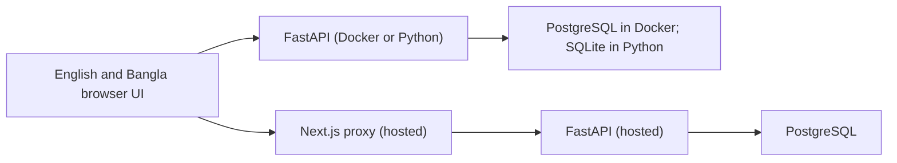

# Architecture

The browser interface calls one same-origin API. Docker and the Python fallback serve the UI and API together. The optional hosted profile keeps provider details and the upstream credential on the Next.js server. Both run the same validation, personalization and storage logic.

| Boundary | Implementation |
| --- | --- |
| UI | `web/public/steadyday`: route views, native forms, English and Bangla copy, charts with table equivalents and the sample-value helper. `web/app`: Next.js shell, static asset loading and API route adapter. |
| Hosted proxy | `web/lib/proxy.ts` allowlists routes and methods, checks the exact write origin, enforces a streamed body limit of 8 KiB for check-ins and 2 KiB for other writes, and uses a five-second upstream timeout. The upstream origin and key are only available on the Next.js server. |
| API and policy | `main.py` routes/session gate; `models.py` strict DTOs; `service.py` scoped operations, seeds and calendar math; `recommend.py` safeguard and retrieval. |
| Storage | `db.py`: parameterized shared SQL, SQLite transactions or SQLAlchemy Core with psycopg and a bounded pool. `schema.sql`: constraints, keys and bootstrap. Schema bootstrap uses a PostgreSQL advisory lock in the hosted profile. |

See the [database schema](DATABASE_SCHEMA.md) and [API documentation](API_DOCUMENTATION.md) for storage, routes and request formats.

## Design limits

Sessions are fictional, browser-scoped, and expire. A release that collects real wellbeing information would require independent privacy and security review, durable user authentication, ingress throttling, and operational monitoring. See [Security](SECURITY.md).
