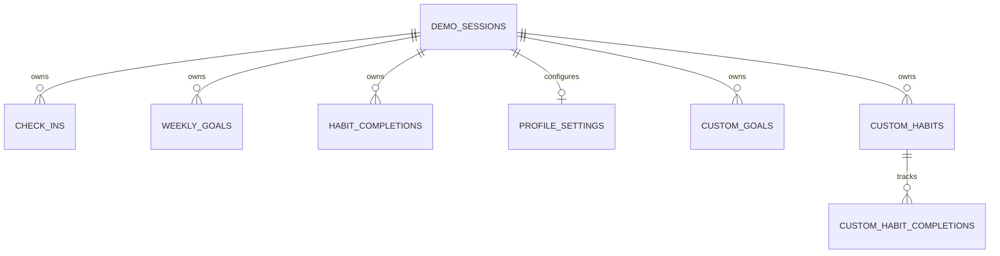

# Database schema

- **demo_sessions:** random internal ID, unique token hash, fictional persona, consent version, creation/expiry timestamps and optional reminder minute. Expiry is indexed.
- **check_ins:** primary key `(session_id, day)` with sleep, movement, energy, optional mood, stress, hydration, notes, and a sample flag. Changes are limited to the most recent 14 days in the configured timezone. Saving twice on one day updates one row.
- **weekly_goals:** primary key `(session_id, week_start)`; activity and check-in days (1–7 each). The week starts Monday. The most recent target carries into the next week until changed.
- **habit_completions:** primary key `(session_id, day, habit)`. Each record marks a completed preset routine. Undo removes the row. The dashboard shows the current week and export includes all saved weeks.
- **profile_settings:** one row per session with display name, language, appearance, and reminder and browser notification preferences. An earlier session uses defaults until a profile is saved.
- **custom_goals:** session-scoped goal ID, week, title, and completion state.
- **custom_habits** and **custom_habit_completions:** session-scoped habit IDs and titles. The completion table stores one completion per habit and date. Deleting a habit deletes its completions.
- Session deletion cascades; reads and writes scope by the server-resolved session ID. Historical samples are relative to session creation. A logged day with at least 10 movement minutes counts in the demo; it is a product convention, not health guidance.

Startup applies additive schema changes to existing SQLite and PostgreSQL stores. Older check-ins retain their values and leave newly added fields empty. Use the existing Compose volume when upgrading.
